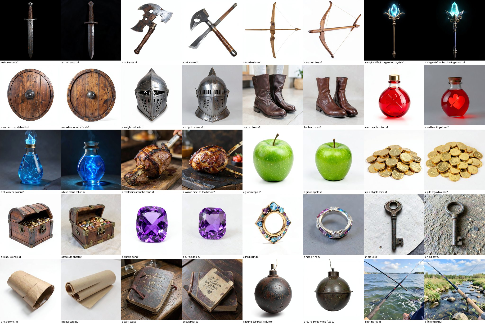
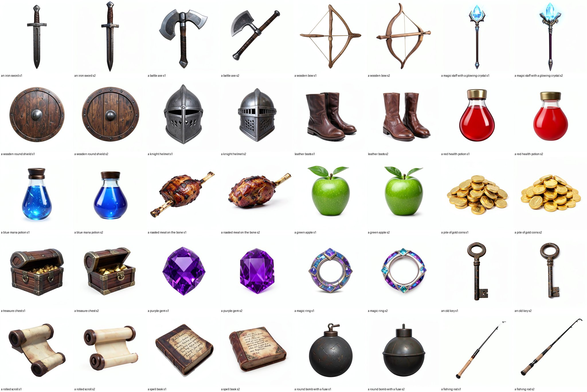
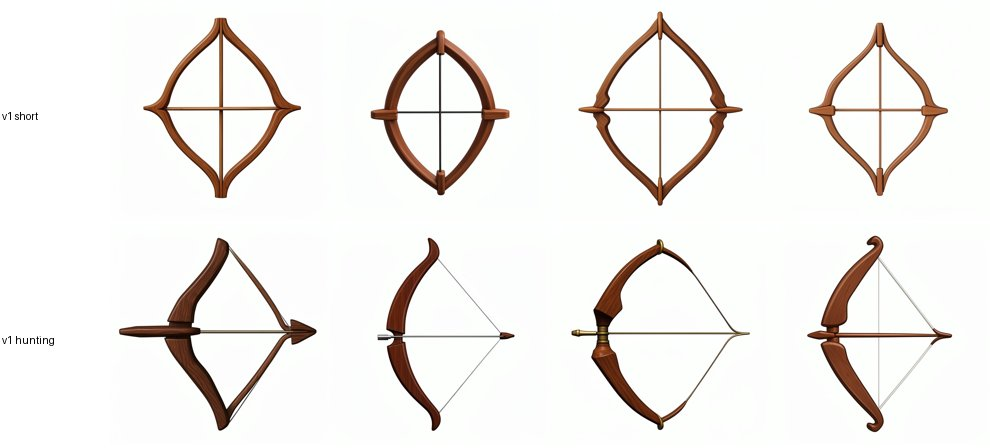

# kibako items-klein4b

A LoRA for [FLUX.2 [klein] 4B](https://huggingface.co/black-forest-labs/FLUX.2-klein-base-4B) that turns a bare item name into a game item icon on a plain white background.

Without the LoRA, `an iron sword` gives a photograph. With it, you get a single centered icon, with no prompt engineering.

| Base model, plain prompt | + this LoRA (base-4B, 25 steps) | + this LoRA (distilled 4B, 4 steps) |
|---|---|---|
|  |  |  |

(The prompts are the plain item names `an iron sword`, `a battle axe`, ... with seeds 1 and 2. The base column is the distilled 4B model with 4 steps.)

## Usage

```python
import torch
from diffusers import DiffusionPipeline

pipe = DiffusionPipeline.from_pretrained(
    "black-forest-labs/FLUX.2-klein-base-4B", torch_dtype=torch.bfloat16
).to("cuda")
pipe.load_lora_weights("ttreetoshi/kibako-items-klein4b")

image = pipe(
    prompt="a treasure chest",
    width=1024, height=1024,
    num_inference_steps=25, guidance_scale=4.0,
).images[0]
```

- Trained on `FLUX.2-klein-base-4B`; use 25 steps and guidance 4 there.
- It also loads on the distilled `FLUX.2-klein-4B` (4 steps, guidance 1). The icon framing carries over, but the style is more realistic and the effect is weaker.
- Prompt with the bare item name (`a red health potion`). There is no trigger word.

## Training

- Base: `black-forest-labs/FLUX.2-klein-base-4B` (Apache-2.0).
- Data: 262 images of 132 generic items, **generated by `FLUX.2-klein-4B`** with the prompt `game item icon of {item}, single object, centered, plain white background` (4 candidates per item, hand-picked, automatic white-background / margin check). The caption of each image is the item name alone, so the LoRA learns the icon style from the name.
- LoRA rank 32 / alpha 32, batch size 2, AdamW, lr 1e-4, bf16, 768 and 1024 px. The run was 2000 steps and **the released weights are the step 1500 checkpoint**; step 2000 had started to lose shapes (potions turned into gems, bows into sticks).
- The full recipe is in `train.yaml`; every image, prompt and seed is in `manifest.jsonl` (the dataset is published as `ttreetoshi/kibako-items-klein4b-data`).

## Limits

- It is a style LoRA: it does not teach the base model objects it cannot draw. Items the base model gets wrong (crossbows, slings, long spears, maps, tarot cards, ...) were left out of the training set and stay unreliable.
- **Bows:** the bare prompt `a wooden bow` gives a symmetric diamond-shaped bow with a crossed string. Describing the shape works: `a wooden hunting bow, side view, strung` gave a proper bow on all 4 seeds tried (top row below is the bare prompt, bottom row the descriptive one). Training with bow images did not give a better model: long captions made it worse, and 16 bows drawn from procedural sketches fixed the bare prompt but made boned meat, fishing rods, bombs and subject size worse across the other items. So this is documented rather than trained away.



- `a roasted meat on the bone` often looks like a club.
- Text on items (books, maps) is not legible.
- Single objects only. It was not trained for sprite sheets, characters or scenes.
- Not pixel art. Output is smooth, painted-looking icons at 1024 px.
- Evaluated by eye on 20 fixed items x 2 seeds; there is no quantitative benchmark.

## Commercial use

- Base model: Apache-2.0.
- Training data: images generated by an Apache-2.0 model, whose license places no restriction on its outputs. Each manifest entry records the generator, the exact weights revision, the prompt and the seed.
- This LoRA: Apache-2.0.

Do not prompt for existing characters, brands or other third-party IP. Whether AI-generated images are protected by copyright differs by jurisdiction; this is not legal advice. See the [licensing policy](https://github.com/hayatree/kibako-2d/blob/main/docs/licensing.md).
